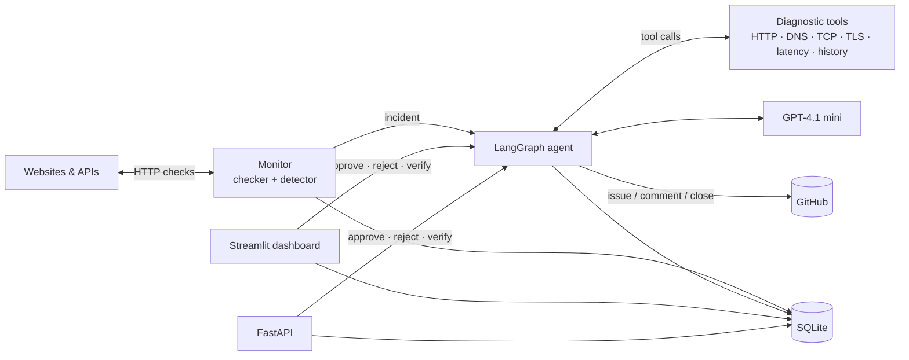
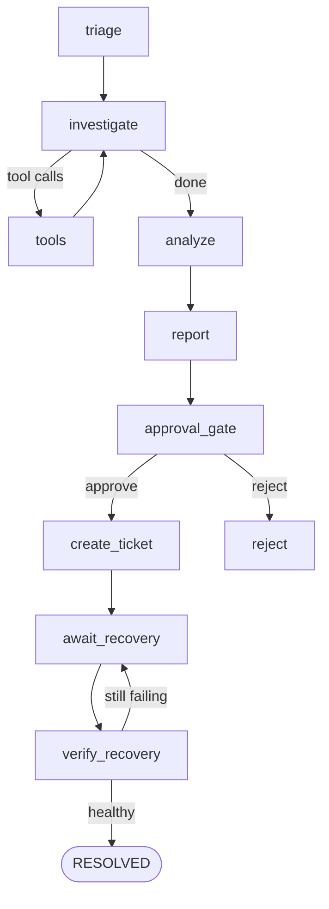
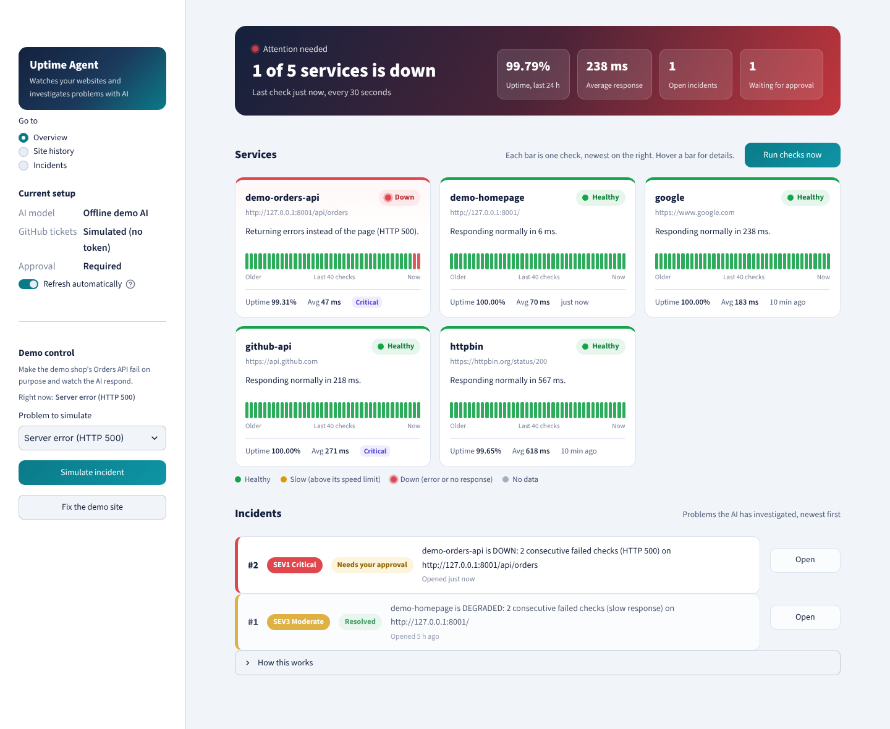
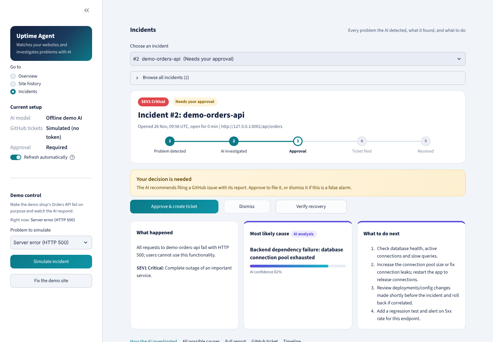
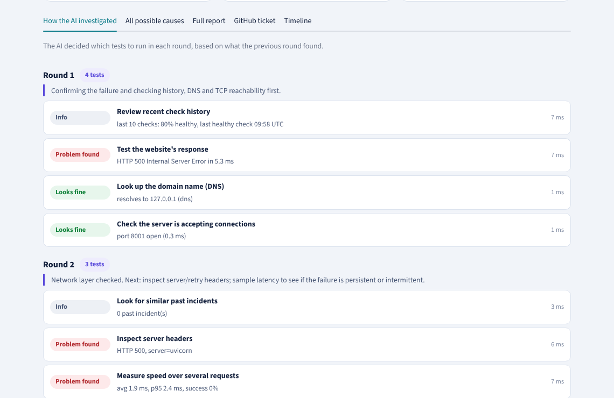

# AI Website Uptime Monitoring & Incident Response Agent

[](https://github.com/tanmayagarwal18/ai-uptime-incident-agent/actions/workflows/ci.yml)


An AI-powered application that monitors websites and APIs, detects failures and then **investigates them on its own**. An LLM agent chooses and runs diagnostic tools, finds the likely root cause, classifies severity, writes an incident report, opens a **GitHub issue** after human approval, and **verifies recovery**.

> Conventional monitors stop at the alert. This agent continues: it investigates the failure, explains the cause, files the ticket and confirms the fix.

---

## ✨ Features

- **Continuous monitoring** of any number of websites and APIs (status code, response time, connection, DNS, TLS and timeout errors)
- **Failure detection with debounce**: an incident opens only after *N* consecutive failures, with no duplicates
- **Agentic investigation (LangGraph + GPT-4.1 mini)**: the LLM picks from 9 diagnostic tools and decides what to check next based on earlier results
- **Structured analysis**: ranked probable causes with evidence, **SEV1–SEV4** severity with a rationale, impact, ordered corrective actions and a confidence score
- **Incident reports** in Markdown (evidence table, triggering checks, timeline), downloadable from the dashboard
- **Human-in-the-loop approval** before any GitHub action (LangGraph `interrupt`, persisted with a SQLite checkpointer)
- **GitHub integration** through the REST API: issue with `incident` / `severity:SEVx` / `site:<name>` labels, recovery comment, auto-close
- **Recovery verification**, on demand or automatic once the monitor sees the site healthy again
- **Streamlit dashboard** with KPIs, latency charts, status timeline, agent investigation trace, approval buttons and a **demo control panel**
- **FastAPI backend** with Swagger docs
- **Works fully offline**: without API keys it uses a deterministic mock LLM and a GitHub dry-run, which makes demos reliable

## 🏗️ Architecture



### Agent workflow



More detail, including the lifecycle state machine and data model, is in [docs/architecture.md](docs/architecture.md).

### Diagnostic tools available to the agent

| Tool | Purpose |
|---|---|
| `http_probe` | Status, latency, content type, error-body preview |
| `check_redirects` | Redirect chain, loops, HTTPS→HTTP downgrade |
| `inspect_headers` | Server, Retry-After, CDN, rate-limit headers |
| `resolve_dns` | A/AAAA/CNAME/MX/NS via **dnspython** (NXDOMAIN, SERVFAIL, timeouts) |
| `tcp_port_check` | Open / closed (refused) / filtered |
| `ssl_certificate_check` | Validity, issuer, TLS version, days to expiry |
| `measure_latency_samples` | min/avg/p95, success rate, intermittent failures |
| `get_recent_checks` | When the problem started |
| `get_past_incidents` | Recurring problems |

### Severity criteria

| Level | Meaning |
|---|---|
| **SEV1** | Complete outage of a critical service (refused, DNS failure, all requests 5xx) |
| **SEV2** | Service down or erroring, or a critical service failing intermittently |
| **SEV3** | Degraded: slow responses, intermittent errors on non-critical services |
| **SEV4** | Minor / transient |

## 🧰 Tech stack

| Technology | Purpose |
|---|---|
| Python 3.11+ | Core application logic and monitoring |
| OpenAI GPT-4.1 mini (free via GitHub Models) | AI reasoning, tool selection, incident analysis |
| LangGraph | Agent workflow orchestration, state, interrupts, checkpoints |
| Requests | HTTP health checks and diagnostics |
| dnspython | DNS resolution diagnostics |
| GitHub REST API | Automated incident ticket creation |
| Streamlit + Plotly | Interactive monitoring dashboard |
| SQLite | Incident history, monitoring data, agent checkpoints |
| FastAPI | Backend REST API |
| pytest, responses, ruff, GitHub Actions | Tests, HTTP mocking, linting, CI |

## 🚀 Setup

```bash
git clone https://github.com/tanmayagarwal18/ai-uptime-incident-agent.git
cd ai-uptime-incident-agent
python -m venv .venv
source .venv/bin/activate          # Windows: .venv\Scripts\activate
pip install -r requirements.txt
cp .env.example .env               # Windows: copy .env.example .env
```

Edit `.env`. Everything is optional: with no token the project uses the offline demo AI and simulated tickets.

| Variable | Default | Notes |
|---|---|---|
| `LLM_PROVIDER` | `github_models` | `github_models` (free GPT-4.1 mini), `openai`, `openai_compatible` or `auto` |
| `OPENAI_MODEL` | `gpt-4.1-mini` | Model name |
| `GITHUB_TOKEN` | *(empty)* | Used for both free GPT-4.1 mini and incident tickets (see below) |
| `GITHUB_REPO` | `owner/repo` | Repository where incident issues are created |
| `LLM_FALLBACK_TO_MOCK` | `true` | If the AI service fails (free limit, bad token), finish with the offline AI |
| `OPENAI_API_KEY` / `OPENAI_BASE_URL` | *(empty)* | Only for the paid OpenAI API or another OpenAI-compatible server |
| `REQUIRE_HUMAN_APPROVAL` | `true` | `false` lets the agent file tickets automatically |
| `AUTO_VERIFY_RECOVERY` | `true` | Monitor resolves ticketed incidents once the site is healthy |
| `CHECK_INTERVAL_SECONDS` | `30` | Monitoring interval |

Monitored targets live in [`config/sites.yaml`](config/sites.yaml).

### Free GPT-4.1 mini + GitHub tickets with one token
The agent uses **GPT-4.1 mini through [GitHub Models](https://github.com/marketplace/models)**, which every GitHub account can use for free within rate limits. One fine-grained token covers both the AI and the tickets:

1. GitHub → **Settings → Developer settings → Personal access tokens → Fine-grained tokens → Generate new token**
2. **Repository access:** Only select repositories → this repo
3. **Permissions:**
   - Repository permissions → **Issues: Read and write** (incident tickets)
   - Account permissions → **Models: Read-only** (free GPT-4.1 mini)
4. In `.env` set:
   ```
   LLM_PROVIDER=github_models
   GITHUB_TOKEN=github_pat_...
   GITHUB_REPO=<your-username>/ai-uptime-incident-agent
   ```
5. Check it works: `python scripts/check_ai.py`

The free tier is rate-limited (roughly 15 requests/minute and 150/day for GPT-4.1 mini). One incident uses 3–6 AI requests. If the limit is reached, the incident is finished by the offline demo AI and the dashboard says so.

**Other options:** `LLM_PROVIDER=openai` with `OPENAI_API_KEY` (paid OpenAI API), or `LLM_PROVIDER=openai_compatible` with `OPENAI_BASE_URL` and `OPENAI_MODEL` for Groq, Google Gemini or a local Ollama model.

## ▶️ Running

| Component | Make | Plain command |
|---|---|---|
| Demo target server | `make demo-server` | `python -m uvicorn demo.flaky_server:app --port 8001` |
| Monitor + agent | `make monitor` | `python scripts/run_monitor.py` |
| Dashboard | `make dashboard` | `python -m streamlit run dashboard/streamlit_app.py` |
| REST API | `make api` | `python -m uvicorn app.api.main:app --port 8000` |
| Seed 24 h history | `make seed` | `python scripts/seed_demo_data.py --reset` |
| Check AI connection | - | `python scripts/check_ai.py` |
| CLI end-to-end | `make simulate` | `python scripts/simulate_incident.py --mode error_500 --approve --heal` |
| Tests / lint | `make test` / `make lint` | `pytest` / `ruff check .` |

Dashboard: http://localhost:8501 · API docs: http://127.0.0.1:8000/docs

## 🎬 3-minute demo

1. `make seed`, then start the **demo server**, **monitor** and **dashboard** in three terminals.
2. **Overview** shows live status, uptime and latency for 5 sites.
3. Sidebar → **Demo control** → `error_500` → **Simulate incident**. The Orders API starts failing and the incident opens.
4. **Agent investigation trace**: the agent chose its own tools. Round 1 checked history, HTTP, DNS and TCP; round 2 inspected headers and sampled latency.
5. **Root cause & actions**: *database connection pool exhausted*, **SEV1**, with evidence and ordered actions.
6. **Approve & create ticket** creates the GitHub issue with labels (or a dry-run payload).
7. **Fix the demo site** → **Verify recovery** marks the incident **RESOLVED** and closes the issue with a comment.

The full script with talking points is in [demo/demo_script.md](demo/demo_script.md).

| Failure mode | What the agent concludes |
|---|---|
| `error_500` | Database connection pool exhausted (SEV1, critical service) |
| `error_503` | Overloaded / no healthy upstream (uses `Retry-After`) |
| `slow` | Performance degradation (SEV3) |
| `timeout` | Hung application / dependency timeout |
| `intermittent` | Intermittent 5xx (lower severity) |
| `not_found` | Missing route after a bad deploy |
| server stopped | Service process down: connection refused (SEV1) |

## 📁 Project structure

```
├── app/
│   ├── config.py            settings (.env) + sites.yaml loader
│   ├── models.py            pydantic schemas (CheckResult, Diagnosis, ...)
│   ├── db.py                SQLite schema + data access
│   ├── services.py          shared actions (run checks, simulate, stats)
│   ├── monitor/             checker, detector (debounce), scheduler
│   ├── tools/               9 LangChain diagnostic tools
│   ├── agent/               LangGraph state, prompts, nodes, graph, runner, mock LLM
│   ├── integrations/        GitHub REST client (dry-run capable)
│   ├── reporting/           Markdown incident report
│   └── api/                 FastAPI backend
├── dashboard/streamlit_app.py
├── demo/                    flaky demo server + demo script
├── scripts/                 run_monitor, seed_demo_data, simulate_incident
├── config/sites.yaml
├── docs/architecture.md
└── tests/                   44 tests, fully offline
```

## 📸 Screenshots

**Overview:** the banner colour follows overall health; each card shows the last 40 checks.



**Incident case file:** progress, the decision needed, and the AI's findings in plain language.



**How the AI investigated:** the tests it chose in each round and what each one found.



## 🔭 Future work

- Slack / email / PagerDuty notifications
- Safe auto-remediation (restart service, roll back deploy) behind approval
- Multi-region checks and synthetic user journeys
- Anomaly detection on latency baselines
- Post-incident review generation from resolved incidents

## 📄 License

MIT
