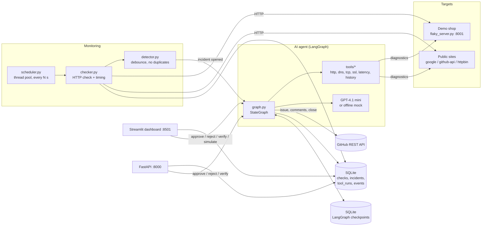
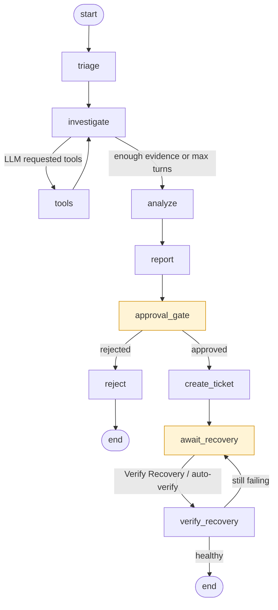
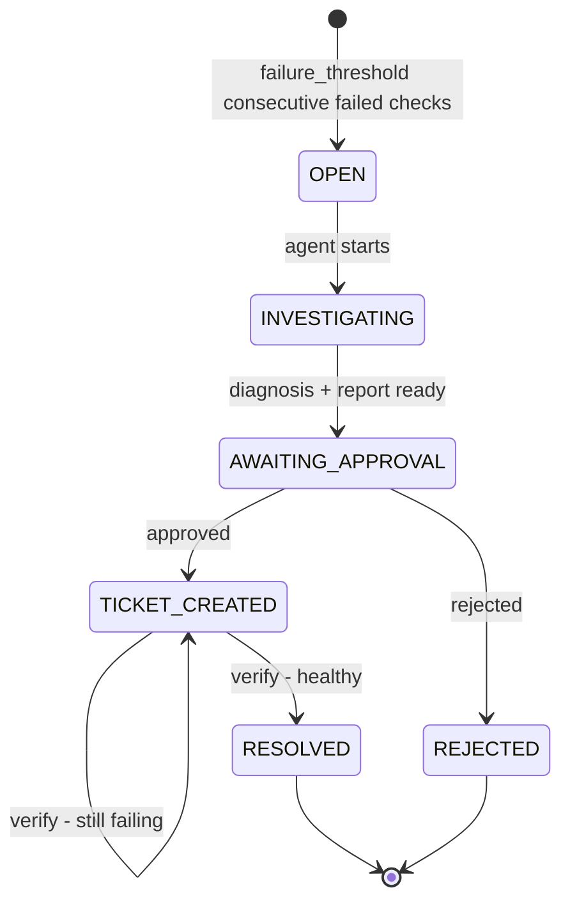

# Architecture

## System overview

## Agent graph

Yellow nodes pause the graph with a LangGraph `interrupt()`. The state is saved by `SqliteSaver`
(thread id `incident-<id>`), so the dashboard, the API or the CLI can resume it later, even after a restart.

| Node | What it does |
|---|---|
| `triage` | Loads the incident and triggering checks, writes the investigation brief, sets status `INVESTIGATING` |
| `investigate` | The LLM (bound to 9 tools) decides which diagnostics to run next, or stops |
| `tools` | Runs the requested tools in parallel and logs each call to `tool_runs` |
| `analyze` | Structured output → `Diagnosis` (ranked causes + evidence, SEV1–SEV4, impact, actions, confidence) |
| `report` | Renders the Markdown incident report |
| `approval_gate` | Human-in-the-loop: waits for Approve/Reject (skipped if `REQUIRE_HUMAN_APPROVAL=false`) |
| `create_ticket` | GitHub issue with labels `incident`, `severity:SEVx`, `site:<name>` (or dry-run payload) |
| `await_recovery` | Waits until someone (or the monitor's auto-verify) asks for a recovery check |
| `verify_recovery` | Re-checks the site: healthy → `RESOLVED`, comment + close issue; else comment and wait again |

## Incident lifecycle

## Data model (SQLite)

| Table | Purpose |
|---|---|
| `sites` | Configured targets (synced from `config/sites.yaml`) |
| `checks` | Every health check: status, HTTP code, response time, error type |
| `incidents` | Status, severity, summary, diagnosis JSON, Markdown report, GitHub issue number/URL/payload |
| `tool_runs` | Every diagnostic tool call by the agent: arguments, result, duration, turn |
| `incident_events` | Audit timeline (opened, agent decisions, diagnosed, approved, ticket, resolved…) |

## Offline / degraded modes

| Missing | Behaviour |
|---|---|
| `OPENAI_API_KEY` | `mock_llm.py` acts as the LLM: picks tools in rounds based on earlier results and applies the same severity rules |
| `GITHUB_TOKEN` (or `GITHUB_DRY_RUN=true`) | Issue payload is stored and shown in the dashboard instead of calling GitHub |
| GitHub API error | Logged as a `TICKET_FAILED` event, payload kept locally, workflow continues |
